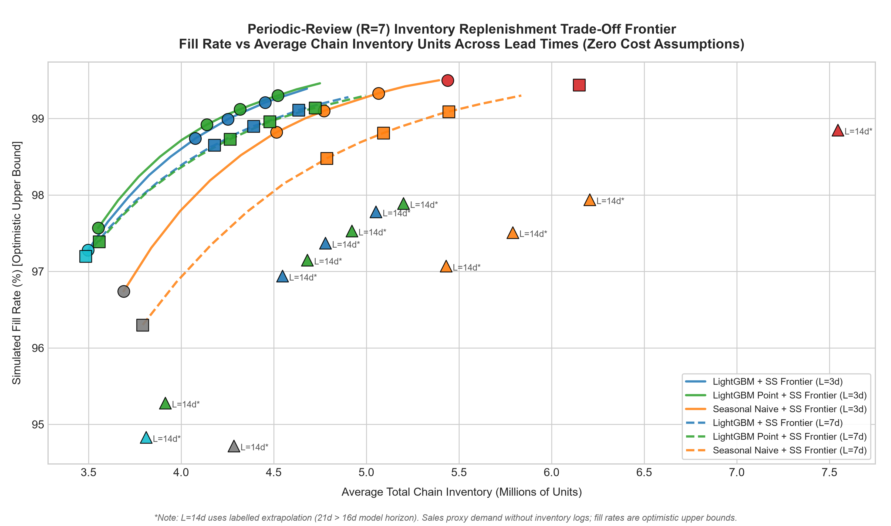

# Corporación Favorita Demand Planner: Portfolio project on public Favorita data

> End-to-end ML demand forecasting and inventory replenishment system for an Ecuadorian supermarket chain (54 stores, 33 product families), reducing walk-forward forecast error from **16.33% to 13.49% WAPE** (**17.39% relative error reduction**, +2.84 pts FVA) and delivering a **-12.27% to -14.51% average simulated inventory reduction** at a matched 99.0% fill rate under periodic review replenishment.

[](https://github.com/lazycoder52/grocery-demand-planner/actions/workflows/ci.yml)
[](pyproject.toml)
[](LICENSE)

---

## 1. Headline Results

### Primary Walk-Forward Evaluation: 5-Fold Rolling-Origin Backtest
Evaluated across **5 expanding-window folds** (16-day horizons; origins stepping every 16 days from 2017-05-11 to 2017-07-14) covering all **54 stores** and **33 product families** (pre-opening zero rows cleanly excluded from training):

| Model | Mean WAPE (%) | WAPE Std (%) | Mean Bias (%) | Mean MAE (Units) | Operational Status |
| :--- | :---: | :---: | :---: | :---: | :--- |
| **LightGBM Global Regressor** | **13.49%** | **±0.98%** | **-0.76%** | **65.21** | **Selected Model** |
| Seasonal Naive (7-Day Lag) | 16.33% | ±1.29% | -1.58% | 78.99 | Retail Benchmark |
| 28-Day Moving Average | 23.65% | ±1.03% | +0.80% | 114.26 | Moving Average Baseline |
| Last-Value Naive | 27.83% | ±2.67% | -10.81% | 134.73 | Heuristic Benchmark |

> **Cross-Validation Forecast Value Added (FVA):** LightGBM consistently outperforms the strongest seasonal baseline across all 5 folds, delivering a mean **+2.84 percentage points** of WAPE reduction (**17.39% relative error reduction**).

### Single-Window Out-of-Time Confirmation: Holdout Window (2017-07-31 to 2017-08-15)
Evaluated as a single-window out-of-time confirmation on the final unseen 16-day window (**28,512 store-family predictions**, totaling **13,319,179.78 units sold**):

| Model | WAPE (%) | Bias (%) | MAE (Units) | RMSLE | Status |
| :--- | :---: | :---: | :---: | :---: | :--- |
| **LightGBM Global Regressor** | **15.29%** | **+2.46%** | **71.42** | **0.4069** | **Selected Model** |
| Seasonal Naive (7-Day Lag) | 20.67% | +0.41% | 96.54 | 0.6170 | Retail Benchmark |
| 28-Day Moving Average | 20.81% | +1.34% | 97.22 | 0.5216 | Moving Average Baseline |
| Last-Value Naive | 44.42% | +34.99% | 207.51 | 0.6595 | Heuristic Benchmark |

> **Holdout FVA:** LightGBM achieves **+5.38 percentage points** of WAPE reduction (**26.02% relative error reduction**) on the holdout window.

---

## 2. Replenishment Policy Benchmark

Under periodic $(R, S)$ replenishment ($R=7, L \in \{3, 7\}$) with strictly out-of-sample forecast error safety stock, the LightGBM point model delivers a **-12.27% to -14.51% average simulated inventory reduction** compared to Seasonal Naive at a matched 99.0% target fill rate:
* **$L = 3$ days:** **-12.27%** [95% Series CI: [-14.59%, -10.05%]; 95% Time-Block CI: [-19.97%, -2.25%]].
* **$L = 7$ days:** **-14.51%** [95% Series CI: [-17.53%, -11.37%]; 95% Time-Block CI: [-21.22%, -7.31%]].

Full benchmark trade-off curves, lead-time autocorrelation ratios (**1.436** at $L=3$, **1.522** at $L=7$), boundary cases (`DAIRY` below frontier, `BABY CARE` above frontier), and the complete 13-family Holm-Bonferroni significance table are detailed in [docs/INSIGHTS.md](docs/INSIGHTS.md#summary-replenishment-benchmark). The simulation headline uses the point model.

---

## 3. Replenishment Frontier


*Figure 1: Achievable fill rate vs. required average inventory units across service levels. LightGBM reaches a given fill rate with less inventory than Seasonal Naive.*

---

## 4. Model Architecture & Trade-Off Matrix

| Architectural Approach | Walk-Forward WAPE | Operational Pros | Operational Cons | Pipeline Decision |
| :--- | :---: | :--- | :--- | :--- |
| **Global LightGBM Regressor** | **13.49%** | Handles non-linear paydays and promotional counters. | Direct forecasting requires lags of at least 16 days. | **Selected Regressor** |
| **Seasonal Naive (7-Day Lag)** | 16.33% | Zero compute, deterministic, robust on stable weekday patterns. | Blind to bi-weekly paydays (15th / month-end) and holiday calendar shifts. | **Baseline Benchmark** |
| **28-Day Moving Average** | 23.65% | Smooths out extreme noise in low-volume stores. | High lag latency. | Baseline |

* **Hyperparameters:** Global LightGBM uses untuned defaults: `objective='regression'`, `n_estimators=200`, `learning_rate=0.08`, `num_leaves=63`, `random_state=42`, `n_jobs=-1`.
* **Training Range:** Training starts on **2015-01-01** because promotion tracking began on 2014-04-01, allowing sufficient feature lag initialization.

---

## 5. Quick Start (3 Commands)

```bash
# 1. Clone repository and install dependencies
git clone https://github.com/lazycoder52/grocery-demand-planner.git && cd grocery-demand-planner
pip install -r requirements-dev.txt && pip install -e . --no-deps

# 2. Run test suite & verify code quality
pytest && ruff check .

# 3. Launch interactive Streamlit application
streamlit run app.py
```

### Reproduce Full Pipeline
```bash
# Full end-to-end pipeline run (~9 minutes; requires Kaggle CSVs in data/raw/)
python -m demand_planner.pipeline
```

### Streamlit Community Cloud Deployment
The dashboard is pre-configured for deployment to [Streamlit Community Cloud](https://streamlit.io/cloud):
1. Fork or push this repository to your GitHub account.
2. Sign in to Streamlit Community Cloud and click **New app**.
3. Select this repository (`lazycoder52/grocery-demand-planner`), branch (`main`), and set the main file path to `app.py`.
4. Click **Deploy!**

> **Zero Raw Data Required:** The dashboard loads tracked parquet and JSON aggregates (< 5 MB total in `outputs/` and `metrics/`), requiring no external storage bucket, database connections, or raw CSV downloads to run.

---

## 6. Data

Due to competition licensing terms, the raw Kaggle Corporación Favorita dataset is not redistributed in this repository. To download raw CSVs, verify file hashes, and set up the local directory structure, refer to [data/README.md](data/README.md).

---

## 7. Operational Assumptions & Limitations

1. **Evaluation Window Restrictions:**
   Model evaluation covers only **2017-05-12 to 2017-08-15** (CV Fold 1 test start through holdout test end). This backtest window excludes December holiday surges, annual peak seasons, and the April 2016 Manabi earthquake emergency relief period.
2. **Sales as Demand Proxy & Simulated Fill Rates:**
   The inventory replenishment simulator uses historical sales as a demand proxy rather than unconstrained customer demand. All reported on-shelf fill rates and inventory reductions are simulated under periodic review policies rather than observed from live physical store shelves. When an item stocks out, true unfulfilled consumer demand is censored.
3. **Out-of-Sample Safety Stock Construction:**
   Safety stock buffers $\sigma_{\text{oos}}$ are strictly calculated from out-of-sample forecast errors from earlier walk-forward origins whose actual sales were fully completed prior to review date $t$.
4. **Observational Promotions:**
   Promotional tracking commenced across Favorita on **2014-04-01**. Promotional lifts reflect observational historical associations on positive-sales days (intensive margin) rather than randomized A/B pricing experiments.
5. **Institutional Calendar Shocks:**
   December 25 is a deterministic chain-wide holiday closure (sales = 0). Demand for Christmas is treated as zero.

### What I Would Do Next
1. **Longer Backtest History (Including December):** Extend rolling-origin backtesting across multiple calendar years to evaluate model robustness during December holiday volume peaks and annual seasonal surges.
2. **Real On-Hand Inventory Data:** Connect actual ERP/WMS stock records, store inventory receipts, and recorded stockout incident logs to measure physical shelf availability and unfulfilled demand directly.
3. **Promotional Effects Controlling for Targeting:** Model promotional response with an econometric design that explicitly controls for marketing targeting and selective discounting (e.g. staggered store rollouts, panel fixed-effects instrumented designs).

---

## 8. Documentation Index

- 📋 **[Product Brief](docs/PRODUCT_BRIEF.md):** 2-page brief with metric tree, 5-store randomized pilot protocol, and scope roadmap.
- 📊 **[Business Insights & SQL](docs/INSIGHTS.md):** Analysis of the 4 SQL analytical views and full per-family Holm-Bonferroni tables.
- 📁 **[Data Card](docs/DATA_CARD.md):** Dataset lineage, schema definitions, missing calendar dates, and store opening audit.
- 📜 **[Changelog](docs/CHANGELOG.md):** Historical iteration and reconciliation records.
- 💻 **[Interactive App](app.py):** Interactive Streamlit dashboard (`streamlit run app.py`).

## License

This project is licensed under the [MIT License](LICENSE).
