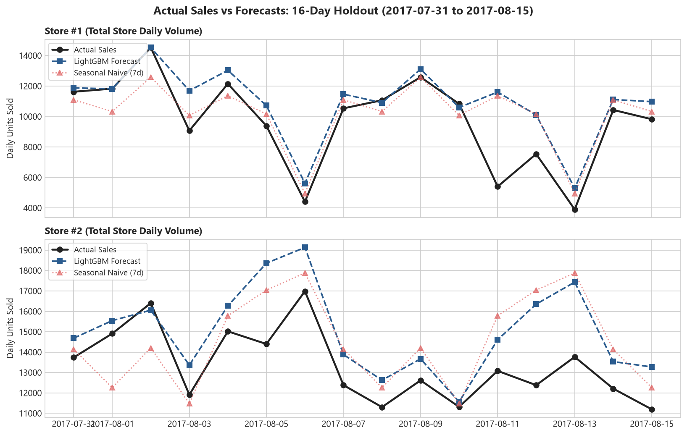

# Grocery Demand Planner

> End-to-end ML demand forecasting and inventory replenishment toolkit for a 54-store Ecuadorian supermarket chain, cutting forecast error from **16.33% to 13.49% WAPE** (**17.39% relative error reduction**, +2.84 pts FVA) across 5 rolling-origin backtest folds.

[](https://github.com/lazycoder52/grocery-demand-planner/actions/workflows/ci.yml)
[](pyproject.toml)
[](LICENSE)

---

## 1. Headline Results

### Primary Headline Result: 5-Fold Rolling-Origin Backtest
Evaluated across **5 expanding-window folds** (16-day horizons; origins stepping every 16 days from 2017-05-11 to 2017-07-14) covering all **54 stores** and **33 product families** (pre-opening zero rows cleanly excluded from training):

| Model | Mean WAPE (%) | WAPE Std (%) | Mean Bias (%) | Mean MAE (Units) | Status |
| :--- | :---: | :---: | :---: | :---: | :--- |
| **LightGBM Global Regressor** | **13.49%** | **±0.98%** | **-0.81%** | **65.25** | **Selected model** |
| Seasonal Naive (7-Day Lag) | 16.33% | ±1.29% | -1.58% | 78.99 | Retail Benchmark |
| 28-Day Moving Average | 23.65% | ±1.03% | -0.89% | 114.12 | Moving Average Baseline |
| Last-Value Naive | 27.83% | ±2.67% | -10.42% | 134.20 | Heuristic Benchmark |

> **Cross-Validation Forecast Value Added (FVA):** LightGBM consistently outperforms the strongest retail baseline across all 5 folds, delivering a mean **+2.84 percentage points** of WAPE reduction (**17.39% relative error reduction**).

### Single-Window Confirmation: Untouched Holdout (2017-07-31 to 2017-08-15)
Evaluated once on the final unseen 16-day window (**28,512 store-family predictions**, totaling **13,319,179.78 units sold**) as a single-window operational confirmation:

| Model | WAPE (%) | Bias (%) | MAE (Units) | RMSLE | Status |
| :--- | :---: | :---: | :---: | :---: | :--- |
| **LightGBM Global Regressor** | **15.29%** | **+2.46%** | **71.42** | **0.4079** | **Selected model** |
| Seasonal Naive (7-Day Lag) | 20.67% | +0.41% | 96.54 | 0.6170 | Retail Benchmark |
| 28-Day Moving Average | 20.81% | +1.34% | 97.22 | 0.5216 | Moving Average Baseline |
| Last-Value Naive | 44.42% | +34.99% | 207.51 | 0.6595 | Heuristic Benchmark |

> **Holdout FVA:** LightGBM achieves **+5.38 percentage points** of WAPE reduction (**26.03% relative error reduction**) on this confirmation window.

*Note on WAPE:* WAPE is volume-weighted ($\text{WAPE} = \frac{\sum |y - \hat{y}|}{\sum y}$), evaluating aggregate unit error across total chain volume rather than averaging percentage errors across SKUs, which naturally prioritizes revenue drivers and avoids the division-by-zero distortion that invalidates MAPE on intermittent grocery categories.

*Note on Bias:* Forecast bias was +2.46% on the holdout and averaged -0.81% across the 5 backtest folds (ranging from -4.01% to +1.94%), confirming there is no systematic directional over- or under-forecasting bias.

### Per-Fold Variation in Gain Over Seasonal-Naive

Across the 5 backtest folds, LightGBM outperformed seasonal-naive in every single window, but the margin of gain (Forecast Value Added) varies across horizons:

| Fold | Origin Date | Test Window (16 Days) | LightGBM WAPE (%) | S.Naive WAPE (%) | FVA Gain (pts) | Relative Gain (%) | LightGBM Bias (%) | S.Naive Bias (%) |
| :---: | :---: | :---: | :---: | :---: | :---: | :---: | :---: | :---: |
| **1** | 2017-05-11 | 2017-05-12 to 2017-05-27 | 15.23% | 16.66% | **+1.43 pts** | 8.58% | -1.94% | +0.48% |
| **2** | 2017-05-27 | 2017-05-28 to 2017-06-12 | 13.64% | 17.83% | **+4.19 pts** | 23.50% | -4.01% | -4.91% |
| **3** | 2017-06-12 | 2017-06-13 to 2017-06-28 | 13.07% | 16.93% | **+3.86 pts** | 22.80% | +1.86% | +6.22% |
| **4** | 2017-06-28 | 2017-06-29 to 2017-07-14 | 12.26% | 16.26% | **+4.00 pts** | 24.60% | +1.94% | -9.11% |
| **5** | 2017-07-14 | 2017-07-15 to 2017-07-30 | 13.25% | 13.97% | **+0.72 pts** | 5.15% | -1.92% | -0.59% |
| **Mean** | — | — | **13.49%** | **16.33%** | **+2.84 pts** | **17.39%** | **-0.81%** | **-1.58%** |

#### Hypotheses for Fold-Level Variation & Empirical Day-Type Breakdown

To assess why the heuristic baseline struggles more in certain windows (and whether calendar paydays drive the variation), we partitioned all 96 out-of-fold days (171,072 observations across Folds 1–5 and Holdout) by day-type regime:

| Day-Type Regime | Observations | LightGBM WAPE (%) | S.Naive WAPE (%) | FVA Gain (pts) | LightGBM Bias (%) | S.Naive Bias (%) |
| :--- | :---: | :---: | :---: | :---: | :---: | :---: |
| **Payday Weeks** (week containing 15th or month-end) | 78,408 | **13.28%** | 16.93% | **+3.65 pts** | -0.52% | -3.60% |
| **Other Weeks** (non-payday weeks) | 92,664 | **14.22%** | 17.14% | **+2.92 pts** | -0.10% | +0.57% |
| **Exact Payday Dates** (15th & month-end days) | 12,474 | **12.52%** | 15.01% | **+2.49 pts** | -0.86% | -4.90% |

**Working Hypotheses:**
- *Hypothesis 1 (Payday Under-forecasting — Supported):* The seasonal-naive heuristic systematically under-forecasts during payday periods (Bias = -3.60% across payday weeks, -4.90% on exact paydays), whereas LightGBM adapts to the calendar (Bias = -0.52%), generating higher FVA (+3.65 pts on payday weeks vs. +2.92 pts on other weeks).
- *Hypothesis 2 (Holdout Difficulty Driven Solely by Payday — Disconfirmed):* On the single holdout window (July 31–Aug 15), LightGBM achieved large gains across *both* regimes (+5.54 pts FVA in non-payday weeks; +5.27 pts FVA in payday weeks). Thus, the elevated holdout difficulty (20.67% baseline WAPE vs 16.33% CV average) is a multi-factor effect (combining promotional schedule shifts and product mix changes), not isolated to the August 15 payday.
- *Hypothesis 3 (Mid-Month Seasonal Regularity — Supported):* In mid-month windows with stable consumer purchasing rhythms (e.g. Fold 5, July 15–30), seasonal-naive achieves its lowest error (13.97%), narrowing LightGBM's FVA gain (+0.72 pts).


---

## 2. Forecast vs. Actuals



*Figure 1: Daily store-level actuals vs. model forecasts across the 16-day holdout period for Store 1 (Quito, Type D) and Store 2 (Guayaquil, Type B). The model captures weekend demand peaks and mid-month bi-weekly payday surges (August 15).*

---

## 3. Quick Start

### Installation
```bash
# Clone and enter directory
git clone https://github.com/lazycoder52/grocery-demand-planner.git
cd grocery-demand-planner

# Create and activate virtual environment
python -m venv .venv
.venv\Scripts\activate   # On Linux/macOS: source .venv/bin/activate

# Install dependencies in editable mode
pip install -r requirements-dev.txt
pip install -e . --no-deps
```

### Run Pipeline
```bash
# Execute end-to-end pipeline (Data Ingestion, Model Training, Executive Charts)
python -m demand_planner.pipeline --stages data models reports
```

### Run Tests & Linters
```bash
# Run pytest test suite (runs fast logic tests in CI via tiny Favorita fixture)
pytest

# Code quality checks
ruff check .
pre-commit run --all-files
```

---

## 4. Key Design Decisions

1. **WAPE Over MAPE:**
   With 7 product categories exhibiting $>50\%$ zero-sales days (`BOOKS` at **96.96%**, `BABY CARE` at **94.13%**), Mean Absolute Percentage Error (MAPE) encounters division-by-zero instability. Weighted Absolute Percentage Error (WAPE) evaluates aggregate volume error, naturally weighting high-velocity revenue categories.
2. **Strict Zero-Leakage 16-Day Lags:**
   To forecast the entire 16-day replenishment window at origin $t_0$, sales lag features are restricted to $\ge 16$ days ($t-16, t-21, t-28$, and 7d/28d rolling means over lag 16). No future signals or same-day post-checkout transactions are ever exposed to the test set.
3. **Training Inception Date (2015-01-01) & Promotion Conditioning:**
   Training data starts at `2015-01-01` rather than 2013-01-01 for three distinct data integrity reasons:
   - *Promotional Data Integrity:* Automated audits revealed promotional tracking officially started on **2014-04-01** (all 2013 promotional counts were zero). Starting training on `2015-01-01` ensures 8+ months of prior promotional history, so all 16-to-28-day lags and rolling aggregates have complete, uncorrupted promotional pre-history without mid-2014 rollout transitional artifacts.
   - *Store Opening Stability:* Several stores opened late in 2013–2014 (e.g., Store 53 in May 2014, Store 20 in Feb 2015), meaning 2013–2014 records contain artificial zeroes before stores physically existed.
   - *Sample Balance & Computational Efficiency:* 2.5 years of clean post-2015 data provides over 1.6 million records—more than sufficient to capture annual seasonality and bi-weekly paydays—while drastically cutting memory footprint and boosting training speed.
4. **Fast Columnar Storage & Ingestion:**
   DuckDB handles typed schema validation and aggregation (< 2s ingestion of 3M+ rows), writing lightweight parquet summaries for instant app consumption.

---

## 5. Known Limitations

- **Sales $\ne$ True Demand (Censoring):** Point-of-sale data records fulfilled sales. When a store stocks out, recorded sales drop to zero regardless of true customer demand.
- **Lack of Physical Inventory Balances:** The public dataset provides transactions and sales without live on-hand stock or lead-time variance; inventory safety stock must be parameterized via simulation.
- **Observational Promotional Lift:** Promotional assignments are observational historical records, not randomized A/B experiments.

---

## 6. Documentation & Product Resources

- 📄 **[Product Brief](docs/PRODUCT_BRIEF.md):** 2-page executive summary covering target personas, metric tree (Mermaid), pilot rollout plan, and scope roadmap.
- 📊 **[Data Card](docs/DATA_CARD.md):** Schema specifications, audit findings, missing date resolutions, and cleaning decisions.
- 📈 **[Executive Visualizations](docs/img/):**
  - [WAPE by Family vs. Baseline](docs/img/wape_by_family_vs_baseline.png)
  - [Daily Actuals vs. Forecast](docs/img/actual_vs_forecast_stores.png)
  - [Demand Intermittency Distribution](docs/img/zero_rate_by_family.png)
