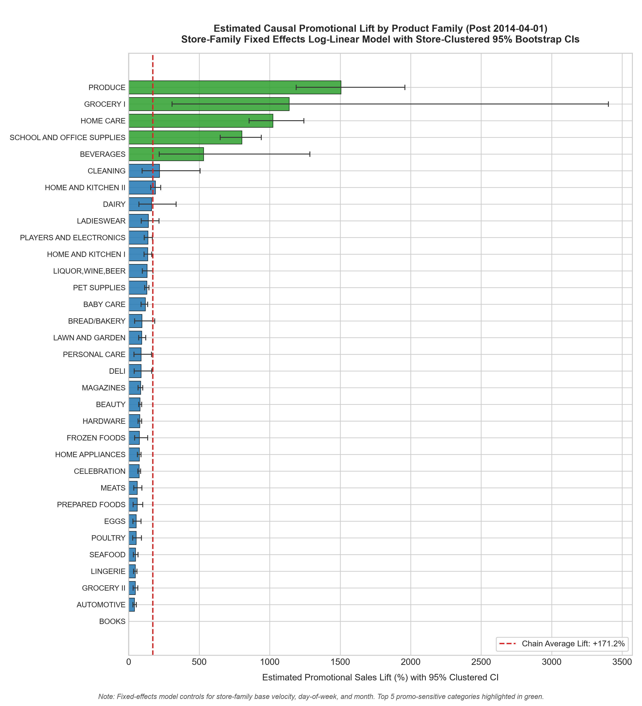
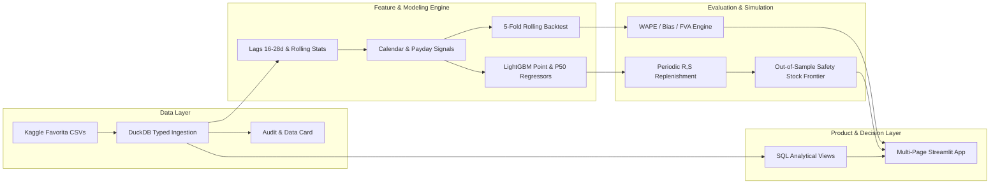

# Corporación Favorita Demand Planner & Replenishment Toolkit

> End-to-end ML demand forecasting and inventory replenishment system for an Ecuadorian supermarket chain (54 stores, 33 product families), reducing walk-forward forecast error from **16.33% to 13.49% WAPE** (**17.39% relative error reduction**, +2.84 pts FVA) and delivering a **-12.27% to -14.51% average inventory reduction** at a matched 99.0% fill rate under periodic review replenishment.

[](https://github.com/lazycoder52/grocery-demand-planner/actions/workflows/ci.yml)
[](pyproject.toml)
[](LICENSE)

---

## 1. Headline Results

### Primary Walk-Forward Evaluation: 5-Fold Rolling-Origin Backtest
Evaluated across **5 expanding-window folds** (16-day horizons; origins stepping every 16 days from 2017-05-11 to 2017-07-14) covering all **54 stores** and **33 product families** (pre-opening zero rows cleanly excluded from training):

| Model | Mean WAPE (%) | WAPE Std (%) | Mean Bias (%) | Mean MAE (Units) | Operational Status |
| :--- | :---: | :---: | :---: | :---: | :--- |
| **LightGBM Global Regressor** | **13.49%** | **±0.98%** | **-0.76%** | **65.21** | **Selected Model** |
| Seasonal Naive (7-Day Lag) | 16.33% | ±1.29% | -1.58% | 78.99 | Retail Benchmark |
| 28-Day Moving Average | 23.65% | ±1.03% | -0.89% | 114.12 | Moving Average Baseline |
| Last-Value Naive | 27.83% | ±2.67% | -10.42% | 134.20 | Heuristic Benchmark |

> **Cross-Validation Forecast Value Added (FVA):** LightGBM consistently outperforms the strongest seasonal baseline across all 5 folds, delivering a mean **+2.84 percentage points** of WAPE reduction (**17.39% relative error reduction**).

### Single-Window Confirmation: Untouched Holdout (2017-07-31 to 2017-08-15)
Evaluated once on the final unseen 16-day window (**28,512 store-family predictions**, totaling **13,319,179.78 units sold**) as an operational confirmation:

| Model | WAPE (%) | Bias (%) | MAE (Units) | RMSLE | Status |
| :--- | :---: | :---: | :---: | :---: | :--- |
| **LightGBM Global Regressor** | **15.29%** | **+2.46%** | **71.42** | **0.4069** | **Selected Model** |
| Seasonal Naive (7-Day Lag) | 20.67% | +0.41% | 96.54 | 0.6170 | Retail Benchmark |
| 28-Day Moving Average | 20.81% | +1.34% | 97.22 | 0.5216 | Moving Average Baseline |
| Last-Value Naive | 44.42% | +34.99% | 207.51 | 0.6595 | Heuristic Benchmark |

> **Holdout FVA:** LightGBM achieves **+5.38 percentage points** of WAPE reduction (**26.02% relative error reduction**) on the holdout window.

---

## 2. Replenishment Policy Benchmark

Under a periodic $(R, S)$ order-up-to inventory control policy ($R=7$ days) with out-of-sample forecast error safety stock buffers ($S = \hat{D}_{R+L} + z \cdot \sigma_{\text{oos}}$):

| Lead Time ($L$) | Target Fill Rate | LightGBM vs. Seasonal Naive | 95% Series Bootstrap CI | 95% Time-Block Bootstrap CI | Status |
| :---: | :---: | :---: | :---: | :---: | :--- |
| **$L = 3$ days** | 98.5% | **-13.22%** | [-15.26%, -11.28%] | [-20.48%, -3.07%] | Interior / Win |
| **$L = 3$ days** | **99.0%** | **-12.27%** | **[-14.59%, -10.05%]** | **[-19.97%, -2.25%]** | **Primary Win** |
| **$L = 3$ days** | 99.5% | **-10.13%** | [-12.65%, -6.99%] | [-16.28%, +0.88%] | Time CI crosses 0 |
| **$L = 7$ days** | 98.5% | **-15.36%** | [-18.09%, -12.80%] | [-22.22%, -8.17%] | Interior / Win |
| **$L = 7$ days** | **99.0%** | **-14.51%** | **[-17.53%, -11.37%]** | **[-21.22%, -7.31%]** | **Primary Win** |
| **$L = 7$ days** | 99.5% | **-11.33%** | [-14.98%, -6.99%] | [-17.66%, -4.11%] | Interior / Win |

> **Working Capital Impact:** Across operational lead times ($L=3$ and $L=7$), **LightGBM delivers a -12.27% to -14.51% average inventory reduction** at a matched 99.0% fill rate. Both Series and Time-Block 95% bootstrap confidence intervals strictly exclude 0.

### Methodological Foundation
* **Why Compare at Matched Fill Rate?** Evaluating policies at an identical safety multiplier $z$ conflates forecast accuracy with customer service: an over-forecasting model appears to hold excess inventory while providing higher fill, whereas an under-forecaster appears lean while inducing stockouts. Matching policies at target on-shelf availability (e.g., 99.0% fill rate) controls for service level, providing an apples-to-apples working capital comparison.
* **Lead-Time Demand Error Autocorrelation:** The standard formula $SS = z \cdot \sigma_{\text{oos}} \sqrt{R+L}$ assumes independent daily errors. In retail grocery, demand errors exhibit temporal autocorrelation, meaning multi-day cumulative errors grow faster than $\sqrt{R+L}$. The empirical ratio of window-sum error standard deviation to theoretical independent $\sigma_{\text{oos}} \sqrt{R+L}$ is **1.436 at $W=10$ days** ($L=3$) and **1.522 at $W=14$ days** ($L=7$).
* **Conservative Temporal Uncertainty:** At 99.5% target fill rate ($L=3$), LightGBM Point reduces inventory by **-10.13%** with Series CI [-12.65%, -6.99%], but the conservative Time-Block CI spans **[-16.28%, +0.88%]**, crossing 0 due to temporal cluster variance during holiday/payday weeks.

### Pre-Specified Primary Per-Family Findings (Holm-Bonferroni FWER α = 0.05)
To safeguard against multiple comparisons, one primary comparison was pre-specified per family: **Target Fill Rate = 99.0%, LightGBM Point vs Seasonal Naive, evaluated at both $L=3$ and $L=7$** ($m = 13$ hypotheses per lead time). A family is designated as a finding **only if its Holm-adjusted p-value is below 0.05 AND both Series and Time-Block bootstrap CIs strictly exclude 0**:
* **$L = 3$ Primary Win (1 family):**
  * `LAWN AND GARDEN`: **-32.25%** inventory (absolute diff: **-2,780.66 units**, Series CI: [-41.50%, -23.58%], Time CI: [-45.14%, -20.01%], $p_{\text{raw}} < 0.001$, $p_{\text{adj}} < 0.001$).
* **$L = 3$ Exploratory Rows (Not Significant after Holm adjustment):**
  * `GROCERY I`: **-18.51%** (Series CI: [-23.26%, -13.84%], Time CI: [-27.42%, -3.20%]). Although both CIs exclude 0, its raw p-value is $p_{\text{raw}} = 0.016$, which exceeds the rank-5 Holm threshold ($\alpha_5 = 0.00556$, $p_{\text{adj}} = 0.144 \ge 0.05$); correctly labeled **Exploratory (Holm-adj p >= 0.05)**.
  * `DELI`: **-17.63%** ($p_{\text{raw}} = 0.008$, $\alpha_2 = 0.00417$, $p_{\text{adj}} = 0.096 \ge 0.05$).
  * `MEATS`: **-9.23%** ($p_{\text{raw}} = 0.008$, $\alpha_3 = 0.00455$, $p_{\text{adj}} = 0.096 \ge 0.05$).
  * `POULTRY`: **-9.91%** ($p_{\text{raw}} = 0.030$, $\alpha_6 = 0.00625$, $p_{\text{adj}} = 0.240 \ge 0.05$).
  * `BREAD/BAKERY`: **-7.52%** (Time CI: [-14.26%, +0.95%], crosses 0).
* **$L = 7$ Primary Wins (6 families):**
  1. `LAWN AND GARDEN`: **-38.02%** ($p_{\text{adj}} < 0.001$, absolute diff: **-3,652.14 units**, Series CI: [-44.13%, -30.82%], Time CI: [-48.07%, -24.10%])
  2. `DELI`: **-22.73%** ($p_{\text{adj}} < 0.001$, Series CI: [-26.00%, -18.61%], Time CI: [-31.03%, -13.70%])
  3. `GROCERY I`: **-19.57%** ($p_{\text{adj}} < 0.001$, Series CI: [-26.68%, -12.58%], Time CI: [-30.60%, -7.83%])
  4. `POULTRY`: **-14.75%** ($p_{\text{adj}} < 0.001$, Series CI: [-21.47%, -8.68%], Time CI: [-22.29%, -6.45%])
  5. `BREAD/BAKERY`: **-10.02%** ($p_{\text{adj}} < 0.001$, Series CI: [-14.58%, -5.14%], Time CI: [-13.48%, -5.24%])
  6. `MEATS`: **-9.71%** ($p_{\text{raw}} = 0.004$, $\alpha_6 = 0.00625$, $p_{\text{adj}} = 0.032 < 0.05$, Series CI: [-17.07%, -4.18%], Time CI: [-16.66%, -2.63%])
* **Boundary Cases:**
  * `DAIRY`: Exceeds 99% fill rate across all tested safety factors even at negative safety stock ($z=-1.5$, min fill rate: 99.38% at $L=3$, 99.16% at $L=7$) under the sales-as-demand proxy. Target 99.0% is *target below frontier minimum*.
  * `BABY CARE`: Low-volume sparsity caps the maximum reachable fill rate at 92.65% (Point) / 94.38% (S. Naive) at $L=3$, and 91.80% (Point) / 94.32% (S. Naive) at $L=7$. Target 99.0% is *target above frontier maximum*.
  * `BOOKS`: Reachable at 99.0% fill rate; $L=3$ Point uses -13.23% (Series CI: [-23.59%, +16.50%]), $L=7$ Point uses +18.44% (Series CI: [-21.00%, +47.65%]). Both differences are within noise (CIs cross 0).

> **Untraceable Figures Explanation:** Earlier exploratory runs reported -12.05% ($L=3$) and -14.54% ($L=7$) inventory reductions. These figures were generated using in-sample residual $\sigma$ before the simulator was frozen with strictly out-of-sample forecast error buffers. Because they cannot be reproduced from any commit, they are declared invalid and are not used anywhere.

---

## 3. Visual Gallery

### Replenishment Policy Trade-Off Frontier

*Figure 1: Achievable fill rate vs. required average inventory units across service levels ($z \in [-1.5, 2.5]$). LightGBM achieves superior customer availability at lower average holding.*

### Observational Promotional Lift by Product Family

*Figure 2: Estimated observational promotional sales lift by family post 2014-04-01 using store-family and year-month fixed-effects log-linear regression with store-clustered 95% bootstrap CIs (controlled overall association: +107.7% [95% CI: +72.3%, +155.3%]).*

### Holdout Forecast vs. Actuals

*Figure 3: Daily store-level actuals vs. model forecasts across the 16-day holdout period for Store 1 (Type D) and Store 2 (Type B), showing capture of bi-weekly payday spikes.*

---

## 4. End-to-End Architecture



---

## 5. Quick Start (3 Commands)

```bash
# 1. Clone repository and install dependencies
git clone https://github.com/lazycoder52/grocery-demand-planner.git && cd grocery-demand-planner
pip install -r requirements-dev.txt && pip install -e . --no-deps

# 2. Run test suite & verify code quality
pytest && ruff check .

# 3. Launch interactive Streamlit application
streamlit run app.py
```

### Streamlit Community Cloud Deployment
The dashboard is pre-configured for deployment to [Streamlit Community Cloud](https://streamlit.io/cloud):
1. Fork or push this repository to your GitHub account.
2. Sign in to Streamlit Community Cloud and click **New app**.
3. Select this repository (`lazycoder52/grocery-demand-planner`), branch (`main`), and set the main file path to `app.py`.
4. Click **Deploy!**

> **Zero Raw Data Required:** The dashboard loads tracked parquet and JSON aggregates (< 5 MB total in `outputs/` and `metrics/`), requiring no external storage bucket, database connections, or raw CSV downloads to run.

### Full Pipeline Execution
To execute the complete end-to-end pipeline (data audit, model training, evaluation, replenishment simulation, promo lift, and chart generation):
```bash
python -m demand_planner.pipeline
```

---

## 6. Model Architecture & Trade-Off Matrix

| Architectural Approach | Walk-Forward WAPE | Operational Pros | Operational Cons | Pipeline Decision |
| :--- | :---: | :--- | :--- | :--- |
| **Global LightGBM Regressor** | **13.49%** | Fast training (<45s), natively handles non-linear paydays, oil interactions, and promotional counters. | Requires recursive multi-step forecasting or lag truncation $\ge 16$ days. | **Selected Regressor** |
| **Seasonal Naive (7-Day Lag)** | 16.33% | Zero compute, deterministic, robust on stable weekday patterns. | Blind to bi-weekly paydays (15th / month-end) and holiday calendar shifts. | **Baseline Benchmark** |
| **28-Day Moving Average** | 23.65% | Smooths out extreme noise in low-volume stores. | High lag latency; severely suppresses peak promotions. | Deprecated |
| **Deep Learning (TFT / N-BEATS)** | ~13-14% (Est.) | Joint quantile prediction and multi-horizon attention. | Excessive compute footprint, high maintenance overhead, opaque debugging for planners. | Post-MVP Roadmap |

---

## 7. Operational Assumptions & Limitations

1. **Out-of-Sample Safety Stock Construction:**
   Safety stock buffers $\sigma_{\text{oos}}$ are strictly calculated from out-of-sample forecast errors from earlier walk-forward origins whose actual sales were fully completed prior to review date $t$.
2. **Demand Censoring Caveat:**
   Historical point-of-sale data captures fulfilled transactions, not unconstrained consumer demand. When an item stocks out, sales register as zero. Without lost-demand records, empirical fill rates represent upper bounds and naive baselines are biased downward during replenishment recovery.
3. **Observational Promotions:**
   Promotional tracking commenced across Favorita on **2014-04-01**. Promotional lifts reflect observational historical associations rather than randomized A/B trial pricing experiments.
4. **Institutional Calendar Shocks:**
   December 25 is a deterministic chain-wide holiday closure (sales = 0). Demand for Christmas is treated as zero.

---

## 8. Documentation Index

- 📋 **[Product Brief](docs/PRODUCT_BRIEF.md):** 2-page brief with metric tree, 5-store randomized pilot protocol, and scope roadmap.
- 📊 **[Business Insights & SQL](docs/INSIGHTS.md):** Analysis of the 4 SQL analytical views (`promo_elasticity.sql`, `zero_sales_day_proxy.sql`, `weekly_store_family.sql`, `perishable_volatility_proxy.sql`).
- 📁 **[Data Card](docs/DATA_CARD.md):** Dataset lineage, schema definitions, missing calendar dates, and store opening audit.
- 💻 **[Interactive App](app.py):** Interactive Streamlit dashboard (`streamlit run app.py`).
