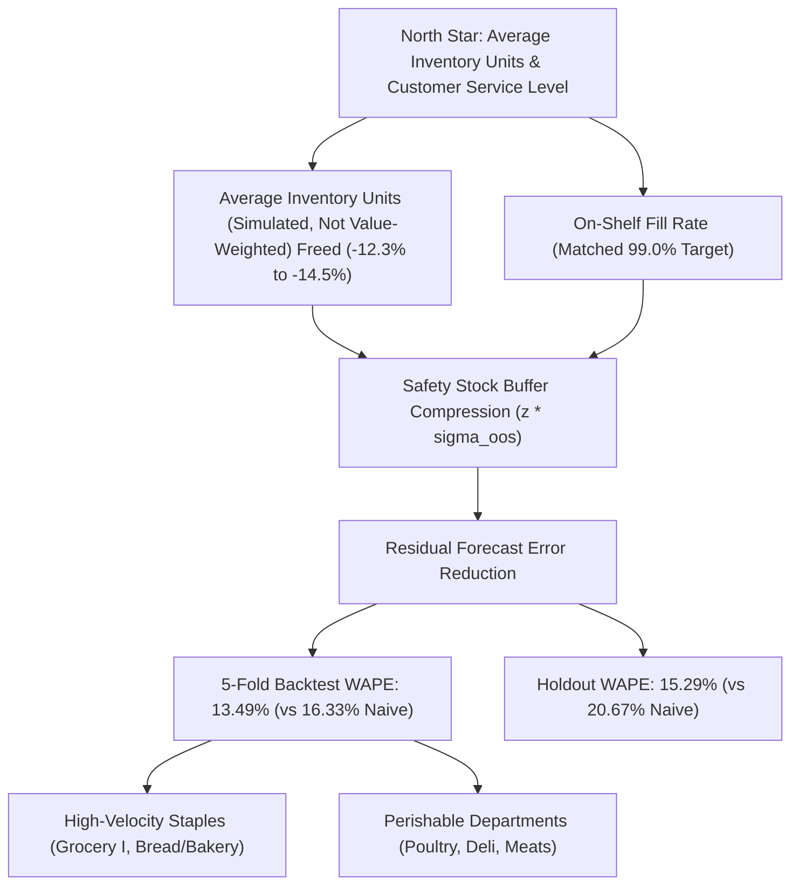

# Product Brief: ML Demand Forecasting & Replenishment System

**Product:** Corporación Favorita Demand Planner
**Author:** lazycoder52
**Public dataset:** Corporación Favorita (Kaggle)
**Status:** portfolio project; simulation-based evidence

---

## 1. Problem Statement & Business Opportunity

Grocery supply chains operate under an unforgiving trade-off: over-replenishing inventory triggers margin-eroding spoilage and holding costs, while under-replenishing leads to unobserved stockouts, lost sales, and degraded customer loyalty.

Across **54 supermarket stores** and **33 product families** in Ecuador (3,000,888 historical daily POS records), static heuristic replenishment rules—such as 7-day seasonal naive repeating and 28-day moving averages—serve as standard retail operational benchmarks.

Walk-forward evaluation against standard retail baselines:
* **7-Day Seasonal Naive:** **16.33% Mean WAPE** across 5 backtest folds; **20.67% WAPE** on the final 16-day holdout.
* **Selected LightGBM Model:** **13.49% Mean WAPE** across 5 backtest folds (**+2.84 pts FVA**, 17.39% relative error reduction); **15.29% WAPE** on the single-window out-of-time confirmation holdout (2017-07-31 to 2017-08-15, **13,319,179.78 units sold**, **+5.38 percentage points FVA**, 26.02% relative error reduction).

### Business Impact: Average Inventory Units (Simulated, Not Value-Weighted) Optimization
Under periodic $(R, S)$ inventory control with out-of-sample error safety stock:
* **Chain-Level Simulated Inventory Reduction:** **-12.27% to -14.51%** average inventory reduction compared to Seasonal Naive at a matched 99.0% fill rate.
  * **$L = 3$ days:** **-12.27%** simulated inventory (95% Series CI: [-14.59%, -10.05%]; 95% Time-Block CI: [-19.97%, -2.25%]).
  * **$L = 7$ days:** **-14.51%** simulated inventory (95% Series CI: [-17.53%, -11.37%]; 95% Time-Block CI: [-21.22%, -7.31%]).
  * Both series and time-block 95% bootstrap confidence intervals strictly exclude 0 across both operational lead times.
* **Why Compare at Matched Fill Rate?** Comparing policies at an identical safety multiplier $z$ conflates forecast accuracy with customer service: an over-forecasting model holds more inventory while achieving higher fill, whereas an under-forecaster appears lean while causing stockouts. Matching policies at target on-shelf availability (e.g. 99.0% fill rate) controls for service level, providing an apples-to-apples average inventory units (simulated, not value-weighted) comparison.
* **Lead-Time Error Autocorrelation:** The empirical ratio of multi-day window-sum error standard deviation to theoretical independent $\sigma_{\text{oos}} \sqrt{R+L}$ is **1.436 at $W=10$ days** ($L=3$) and **1.522 at $W=14$ days** ($L=7$).
* **Conservative Temporal Uncertainty:** At 99.5% target fill rate ($L=3$), LightGBM Point reduces inventory by **-10.13%** with Series CI [-12.65%, -6.99%], but the conservative Time-Block CI spans **[-16.28%, +0.88%]**, crossing 0 under temporal block bootstrap.

---

## 2. Target Personas & Key Decisions Supported

| Persona | Primary Workflow | Key Operational Decision Supported |
| :--- | :--- | :--- |
| **Category Demand Planner** | Weekly replenishment review | Sets order-up-to level $S = \hat{D}_{R+L} + z \cdot \sigma_{\text{oos}}$ by store-family. |
| **Store Operations Manager** | Daily receiving & stockroom staging | Anticipates high-volume delivery days and balances floor shelf labor. |
| **Category Merchant** | Promotional campaign design | Evaluates promotional uplift on positive-sales days (intensive margin). |

---

## 3. Value Driver Metric Tree

---

## 4. Pre-Specified Primary Family Results

See [docs/INSIGHTS.md](INSIGHTS.md#6-pre-specified-primary-family-comparison-tables-metricsjson-replenishment_simulation) for pre-specified per-family comparison tables and multiple-testing corrections.

* **Boundary Reachability Caveats:**
  * `DAIRY`: Target 99.0% fill rate is *target below frontier minimum* (exceeds 99% fill rate across all tested safety factors even at negative safety stock under the sales-as-demand proxy).
  * `BABY CARE`: Target 99.0% fill rate is *target above frontier maximum* (low-volume sparsity caps maximum reachable fill rate at ~92-94%).

---

## 5. Critical Assumptions & Methodological Limitations

1. **Out-of-Sample Safety Stock Construction:** Safety stock residual $\sigma_{\text{oos}}$ is strictly computed from out-of-sample forecast errors originating prior to review date $t$.
2. **Demand Proxy and Censoring Caveat:** Point-of-sale records capture fulfilled transactions, not unconstrained consumer demand. When a stockout occurs, unobserved demand is censored, which can bias naive baselines downward during replenishment recovery.
3. **Observational Promotions:** Promotional tracking commenced on 2014-04-01; promotional lift reflects observational historical co-occurrence on positive-sales days (intensive margin) rather than randomized pricing trials.
4. **Institutional Calendar Shocks:** December 25 is a deterministic chain-wide closure (sales = 0). Bi-weekly paydays (15th and month-end) create recurring non-linear demand spikes.
5. **Excluded Data Sources (Oil & Transactions):** Oil prices and store transaction counts are ingested for analytical aggregation (weekly S&OP views in SQL) but are NOT features in the LightGBM forecasting model. Same-day transactions are simultaneous with sales (leakage risk), and oil prices add external forecasting dependencies without improving store-family walk-forward accuracy.

---

## 6. 5-Store Pilot Implementation Protocol

* **Design:** 6-week randomized controlled field experiment across **10 matched stores** (5 treatment, 5 control).
* **Stratification:** Matched pairs balanced across Store Types (A, B, C, D) and regional clusters in Pichincha and Guayas.
* **Treatment Arm:** Weekly replenishment quantities generated via LightGBM Point forecasts with out-of-sample safety stock ($R=7, L=3$).
* **Control Arm:** Existing 7-day seasonal naive heuristic replenishment schedule.
* **On-Hand Inventory Requirement:** In-store pilot evaluation of true fill rate strictly requires physical on-hand inventory counts and out-of-stock tracking, rather than POS transaction records alone (which cannot distinguish between zero consumer demand and unobserved stockouts).
* **Design Degrees of Freedom:** With 5 treatment vs. 5 control stores observed over 6 weekly replenishment cycles, the cluster-randomized design operates with 8 cluster degrees of freedom.
* **Proposed Pilot Hypothesis Thresholds:**
  1. $\ge 10\%$ reduction in average inventory units (simulated, not value-weighted) tied to stock on shelf (primary inventory hypothesis).
  2. Non-inferior customer on-shelf availability ($\ge 99.0\%$ measured fill rate from daily physical on-shelf audits; non-inferiority margin 0.5 percentage points).
  3. $\le 15\%$ planner manual override rate on recommended replenishment orders (operational adoption hypothesis).

---

## 7. Product Scope: What to Ship First vs. Build Later

| Capability Dimension | What to Ship First (MVP / v1.0) | What to Build Later (Phase 2 & Roadmap) |
| :--- | :--- | :--- |
| **Forecasting Engine** | Global LightGBM point model with lags of at least 16 days | Direct multi-quantile forecasting (P10/P50/P90) & deep learning (TFT) |
| **Replenishment Logic** | Periodic $(R, S)$ order-up-to policy with out-of-sample safety stock | Multi-echelon distribution center to store joint optimization |
| **Service Level Targets** | Frontier service-level tuning grid ($z \in [-1.5, 2.5]$) | Category-specific dynamic service-level optimization based on margins |
| **User Interface** | Interactive Streamlit dashboard & SQL analytical exports | Enterprise ERP / SAP automated purchase order write-back integration |
| **Econometric Controls** | Store-family and year-month fixed effects log-linear regression for promotional lift | Real-time cross-elasticity pricing engine and markdown planner |
