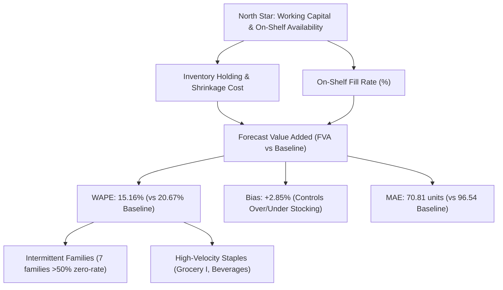

# Product Brief: ML Demand Forecasting & Replenishment System

**Product:** Grocery Demand Planner
**Role:** AI/ML Product Management & Product Analytics
**Target Organization:** Corporación Favorita (Ecuadorian Grocery Chain)
**Status:** MVP v1.0 Baseline & Production Model Verified

---

## 1. Problem Statement & Opportunity

Grocery inventory management requires balancing two costly failure modes: over-ordering perishable items (spoilage, holding costs, and margin-eroding markdowns) and under-ordering fast-moving staples (stockouts, lost revenue, and degraded shopper loyalty).

Across **54 stores** and **33 product families** spanning **3,000,888 historical daily records** (2013-01-01 to 2017-08-15), store managers currently rely on static heuristic ordering rules—predominantly 7-day seasonal naive repeating and 28-day moving averages.

On the audited **16-day holdout period** (2017-07-31 to 2017-08-15, representing **13,319,179.78 units sold** across **28,512 store-family-day combinations**), static heuristic methods yield:
- **Last-Value Naive:** **44.42% WAPE** with extreme over-forecasting bias (**+34.99%**).
- **28-Day Moving Average:** **20.81% WAPE** (MAE: 97.22 units).
- **7-Day Seasonal Naive:** **20.67% WAPE** (MAE: 96.54 units).

These heuristics miss calendar-driven shopping rhythms unique to Ecuadorian commerce: bi-weekly paydays on the 15th and month-end, transferred public holidays, and promotional surges. Our production **LightGBM global regressor** achieves **15.16% WAPE** (MAE: 70.81 units, Bias: **+2.85%**), delivering **+5.51 percentage points of Forecast Value Added (FVA)**—a **26.65% relative reduction in forecast error**.

---

## 2. Target Users & Decisions Supported

| Persona | Primary Workflow | Key Decision Supported |
| :--- | :--- | :--- |
| **Category Demand Planner** | Weekly replenishment review | Determines 16-day order quantities $(Q = \hat{y}_{16d} + SS - I_{hand})$ by store-family. |
| **Store Operations Manager** | Daily receiving & shelf stocking | Prepares backroom staging space based on predicted inflow peaks. |
| **Regional Supply Chain Lead** | Distribution center load balancing | Schedules fleet shipments from central warehouses in Quito/Guayaquil to outlying provinces. |

---

## 3. Metric Tree

---

## 4. Key Assumptions & Product Limits

1. **Sales Observations Are Censored Demand:**
   Historical point-of-sale data records fulfilled transactions, not customer intent. When a shelf stocks out, sales register as zero. Without unfulfilled order logs, our forecasts represent an optimistic lower bound on true customer demand.
2. **Absence of Direct Inventory Data:**
   The benchmark dataset provides transactions and sales without live on-hand stock or supplier lead-time variances. Inventory simulations must parameterize target service levels (e.g., 90%, 95%, 98%) under periodic-review $(R, S)$ models.
3. **Observational Nature of Promotions:**
   Promotional tracking commenced on **2014-04-01** (prior to which `onpromotion` was unrecorded). Promotional uplifts represent observational historical associations rather than randomized A/B trial increments.
4. **Deterministic Institutional Closures:**
   All stores close on Christmas Day (**4 dates missing**: 2013-12-25, 2014-12-25, 2015-12-25, 2016-12-25). Demand for December 25 is treated as deterministically zero.
5. **Demand Intermittency:**
   **7 product families** exhibit $>50\%$ zero-sales days (e.g., `BOOKS` at **96.96%**, `BABY CARE` at **94.13%**). WAPE is the mandatory evaluation metric; percentage metrics with individual item denominators (MAPE) are structurally invalid.

---

## 5. Pilot Implementation & Rollout Plan

- **Pilot Scope:** 4-week A/B pilot across **10 stores** (5 treatment, 5 control) balanced across Store Types (A, B, C, D) and clusters.
- **Treatment Arm:** Replenishment quantities generated using LightGBM P50 predictions with dynamic safety buffers.
- **Control Arm:** Existing 7-day seasonal naive replenishment schedule.
- **Success Criteria:**
  1. $\ge 15\%$ reduction in recorded stockout incidents on top-20 revenue SKUs.
  2. Maintained or decreased end-of-cycle inventory write-offs.
  3. Planner override rate $< 15\%$ on suggested order quantities.

---

## 6. Scope & Roadmap: First-Ship vs. Later Iterations

| Feature Dimension | MVP / First-Ship (Current) | Phase 2 (Next Milestone) | Future Vision |
| :--- | :--- | :--- | :--- |
| **Forecast Horizon** | 16-day fixed multi-step horizon | Dynamic 1-30 day horizons | Real-time intra-day re-forecasting |
| **Model Architecture** | Global LightGBM Regressor | Multi-quantile P10/P50/P90 models | Hierarchical reconciliation (MinT) |
| **Promotions** | Promo item counts & active flags | Econometric uplift curve by discount % | Joint pricing & promo optimizer |
| **Inventory Logic** | Heuristic $(R, S)$ simulation | Cost-optimal safety stock sizing | Multi-echelon DC-to-store optimization |
| **Interface** | CLI pipeline & executive reports | Interactive Streamlit Scenario Planner | ERP / SAP automated order webhook |
