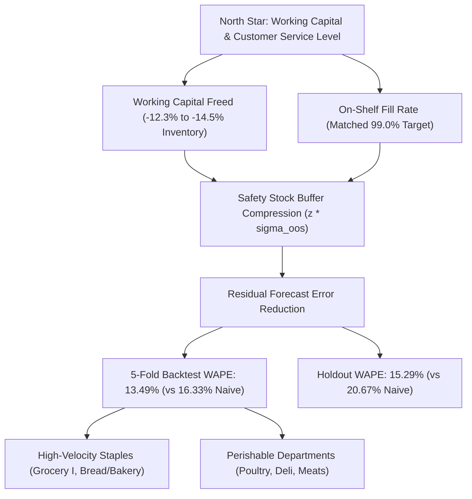

# Product Brief: ML Demand Forecasting & Replenishment System

**Product:** Corporación Favorita Demand Planner
**Role:** AI/ML Product Manager & Senior Product Analyst
**Target Organization:** Corporación Favorita (Ecuadorian Grocery Chain)
**Status:** Validated Pipeline & Re-frozen Replenishment Benchmark

---

## 1. Problem Statement & Business Opportunity

Grocery supply chains operate under an unforgiving trade-off: over-replenishing inventory triggers margin-eroding spoilage and capital holding costs, while under-replenishing leads to phantom stockouts, lost sales, and degraded customer loyalty.

Across **54 supermarket stores** and **33 product families** in Ecuador (3,000,888 historical daily POS records), store inventory replenishment has historically relied on static heuristic ordering rules—predominantly 7-day seasonal naive repeating and 28-day moving averages.

Under walk-forward evaluation, static heuristics prove inadequate:
* **7-Day Seasonal Naive:** **16.33% Mean WAPE** across 5 backtest folds; **20.67% WAPE** on the final 16-day holdout.
* **Selected LightGBM Model:** **13.49% Mean WAPE** across 5 backtest folds (**+2.84 pts FVA**, 17.39% relative error reduction); **15.29% WAPE** on the untouched 16-day holdout (2017-07-31 to 2017-08-15, **13,319,179.78 units sold**, **+5.38 percentage points FVA**, 26.02% relative error reduction).

### Business Impact: Working Capital Optimization
Under periodic $(R, S)$ inventory control with out-of-sample error safety stock:
* **Chain-Level Inventory Reduction:** **-12.27% to -14.51%** average inventory reduction compared to Seasonal Naive at a matched 99.0% fill rate.
  * **$L = 3$ days:** **-12.27%** inventory (95% Series CI: [-14.59%, -10.05%]; 95% Time-Block CI: [-19.97%, -2.25%]).
  * **$L = 7$ days:** **-14.51%** inventory (95% Series CI: [-17.53%, -11.37%]; 95% Time-Block CI: [-21.22%, -7.31%]).
  * Both series and time-block 95% bootstrap confidence intervals strictly exclude 0 across both operational lead times.
* **Why Compare at Matched Fill Rate?** Comparing policies at an identical safety multiplier $z$ conflates forecast accuracy with customer service: an over-forecasting model holds more inventory while achieving higher fill, whereas an under-forecaster appears lean while causing stockouts. Matching policies at target on-shelf availability (e.g. 99.0% fill rate) controls for service level, providing an apples-to-apples working capital comparison.
* **Lead-Time Error Autocorrelation:** The empirical ratio of multi-day window-sum error standard deviation to theoretical independent $\sigma_{\text{oos}} \sqrt{R+L}$ is **1.436 at $W=10$ days** ($L=3$) and **1.522 at $W=14$ days** ($L=7$).
* **Conservative Temporal Uncertainty:** At 99.5% target fill rate ($L=3$), LightGBM Point reduces inventory by **-10.13%** with Series CI [-12.65%, -6.99%], but the conservative Time-Block CI spans **[-16.28%, +0.88%]**, crossing 0 due to temporal cluster variance during holiday/payday weeks.

---

## 2. Target Personas & Key Decisions Supported

| Persona | Primary Workflow | Key Operational Decision Supported |
| :--- | :--- | :--- |
| **Category Demand Planner** | Weekly replenishment review | Sets order-up-to level $S = \hat{D}_{R+L} + z \cdot \sigma_{\text{oos}}$ by store-family. |
| **Store Operations Manager** | Daily receiving & stockroom staging | Anticipates high-volume delivery days and balances floor shelf labor. |
| **Category Merchant** | Promotional campaign design | Sizes supplier buy-in orders using controlled observational promo lift (+107.7% overall association, 95% CI: [+72.3%, +155.3%]). |

---

## 3. Value Driver Metric Tree

---

## 4. Pre-Specified Primary Family Results

To prevent false discovery from multiple comparisons, one primary comparison was pre-specified per family: **Target Fill Rate = 99.0%, LightGBM Point vs Seasonal Naive, evaluated at both $L=3$ and $L=7$** ($m = 13$ hypotheses per lead time). A family is designated as a finding **only if its Holm-adjusted p-value is below 0.05 AND both Series and Time-Block bootstrap CIs strictly exclude 0**:

* **$L=3$ Primary Win (1 family):**
  * `LAWN AND GARDEN`: **-32.25%** inventory (absolute diff: **-2,780.66 units**, Series CI: [-41.50%, -23.58%], Time CI: [-45.14%, -20.01%], $p_{\text{raw}} < 0.001$, $p_{\text{adj}} < 0.001$).
* **$L=3$ Exploratory Rows (Not Significant after Holm adjustment):**
  * `GROCERY I`: **-18.51%** (Series CI: [-23.26%, -13.84%], Time CI: [-27.42%, -3.20%]). Although both CIs exclude 0, raw p-value is $p_{\text{raw}} = 0.016$, exceeding rank-5 Holm threshold ($\alpha_5 = 0.00556$, $p_{\text{adj}} = 0.144 \ge 0.05$); correctly labeled **Exploratory (Holm-adj p >= 0.05)**.
  * `DELI`: **-17.63%** ($p_{\text{raw}} = 0.008$, $\alpha_2 = 0.00417$, $p_{\text{adj}} = 0.096 \ge 0.05$).
  * `MEATS`: **-9.23%** ($p_{\text{raw}} = 0.008$, $\alpha_3 = 0.00455$, $p_{\text{adj}} = 0.096 \ge 0.05$).
  * `POULTRY`: **-9.91%** ($p_{\text{raw}} = 0.030$, $\alpha_6 = 0.00625$, $p_{\text{adj}} = 0.240 \ge 0.05$).
  * `BREAD/BAKERY`: **-7.52%** (Time CI: [-14.26%, +0.95%], crosses 0).
* **$L=7$ Primary Wins (6 families):**
  1. `LAWN AND GARDEN`: **-38.02%** ($p_{\text{adj}} < 0.001$, absolute diff: **-3,652.14 units**, Series CI: [-44.13%, -30.82%], Time CI: [-48.07%, -24.10%])
  2. `DELI`: **-22.73%** ($p_{\text{adj}} < 0.001$, Series CI: [-26.00%, -18.61%], Time CI: [-31.03%, -13.70%])
  3. `GROCERY I`: **-19.57%** ($p_{\text{adj}} < 0.001$, Series CI: [-26.68%, -12.58%], Time CI: [-30.60%, -7.83%])
  4. `POULTRY`: **-14.75%** ($p_{\text{adj}} < 0.001$, Series CI: [-21.47%, -8.68%], Time CI: [-22.29%, -6.45%])
  5. `BREAD/BAKERY`: **-10.02%** ($p_{\text{adj}} < 0.001$, Series CI: [-14.58%, -5.14%], Time CI: [-13.48%, -5.24%])
  6. `MEATS`: **-9.71%** ($p_{\text{raw}} = 0.004$, $\alpha_6 = 0.00625$, $p_{\text{adj}} = 0.032 < 0.05$, Series CI: [-17.07%, -4.18%], Time CI: [-16.66%, -2.63%])
* **Boundary Cases:**
  * `DAIRY`: Exceeds 99% fill rate across all tested safety factors even at negative safety stock ($z=-1.5$, min fill rate: 99.38% at $L=3$, 99.16% at $L=7$) under the sales-as-demand proxy. Target 99.0% is *target below frontier minimum*.
  * `BABY CARE`: Low-volume sparsity caps the maximum reachable fill rate at 92.65% (Point) / 94.38% (S. Naive) at $L=3$, and 91.80% (Point) / 94.32% (S. Naive) at $L=7$. Target 99.0% is *target above frontier maximum*.
  * `BOOKS`: Reachable at 99.0% fill rate; $L=3$ Point uses -13.23% (Series CI: [-23.59%, +16.50%]), $L=7$ Point uses +18.44% (Series CI: [-21.00%, +47.65%]). Both differences are within noise (CIs cross 0).

> **Untraceable Figures Explanation:** Earlier exploratory runs reported -12.05% ($L=3$) and -14.54% ($L=7$) inventory reductions. These figures were generated using in-sample residual $\sigma$ before the simulator was frozen with strictly out-of-sample forecast error buffers. Because they cannot be reproduced from any commit, they are declared invalid and are not used anywhere.

---

## 5. Critical Assumptions & Methodological Limitations

1. **Out-of-Sample Safety Stock Construction:** Safety stock residual $\sigma_{\text{oos}}$ is strictly computed from out-of-sample forecast errors originating prior to review date $t$.
2. **Demand Proxy and Censoring Caveat:** Point-of-sale records capture fulfilled transactions, not unconstrained consumer demand. When a stockout occurs, unobserved demand is censored, which can bias naive baselines downward during replenishment recovery.
3. **Observational Promotions:** Promotional tracking commenced on 2014-04-01; promotional lift reflects observational historical co-occurrence rather than randomized pricing trials.
4. **Institutional Calendar Shocks:** December 25 is a deterministic chain-wide closure (sales = 0). Bi-weekly paydays (15th and month-end) create recurring non-linear demand spikes.

---

## 6. 5-Store Pilot Implementation Protocol

* **Design:** 6-week randomized controlled field experiment across **10 matched stores** (5 treatment, 5 control).
* **Stratification:** Matched pairs balanced across Store Types (A, B, C, D) and regional clusters in Pichincha and Guayas.
* **Treatment Arm:** Weekly replenishment quantities generated via LightGBM Point forecasts with out-of-sample safety stock ($R=7, L=3$).
* **Control Arm:** Existing 7-day seasonal naive heuristic replenishment schedule.
* **Pilot Success Metrics:**
  1. $\ge 10\%$ reduction in average working capital tied to stock on shelf.
  2. Maintained customer on-shelf availability ($\ge 99.0\%$ measured fill rate).
  3. $\le 15\%$ planner manual override rate on recommended replenishment orders.

---

## 7. Product Scope: What to Ship First vs. Build Later

| Capability Dimension | What to Ship First (MVP / v1.0) | What to Build Later (Phase 2 & Roadmap) |
| :--- | :--- | :--- |
| **Forecasting Engine** | Global LightGBM point model with recursive multi-step lags | Direct multi-quantile forecasting (P10/P50/P90) & deep learning (TFT) |
| **Replenishment Logic** | Periodic $(R, S)$ order-up-to policy with out-of-sample safety stock | Multi-echelon distribution center to store joint optimization |
| **Service Level Targets** | Frontier service-level tuning grid ($z \in [-1.5, 2.5]$) | Category-specific dynamic service-level optimization based on margins |
| **User Interface** | Interactive Streamlit dashboard & SQL analytical exports | Enterprise ERP / SAP automated purchase order write-back integration |
| **Econometric Controls** | Store-family and year-month fixed effects log-linear regression for promotional lift | Real-time cross-elasticity pricing engine and markdown planner |
